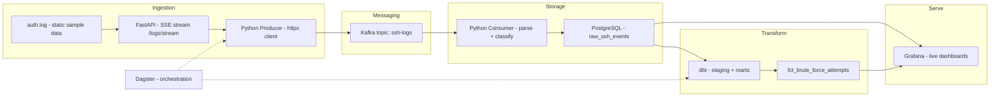
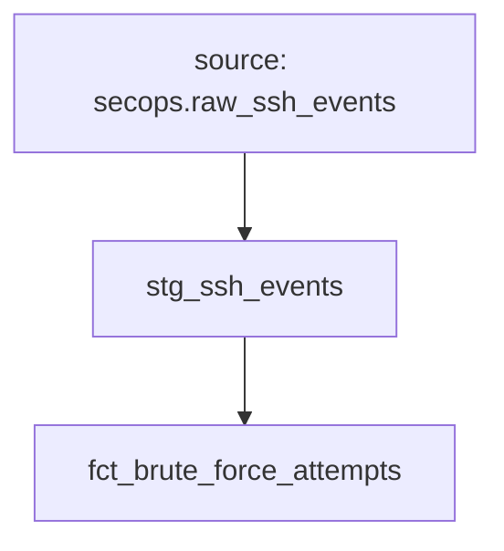

# 🔐 SSH Threat Intelligence Pipeline

**Real-time detection of SSH brute-force attacks using Kafka, PostgreSQL, dbt, Dagster, and Grafana.**

A production-style data engineering pipeline that ingests SSH authentication logs via a streaming API, detects brute-force attacks with SQL-based anomaly detection, and visualizes threats on a live security dashboard.


---

## 📌 Table of Contents

- [Overview](#-overview)
- [Architecture](#-architecture)
- [Tech Stack](#-tech-stack)
- [Project Structure](#-project-structure)
- [Data Source](#-data-source)
- [Data Model](#-data-model)
- [Getting Started](#-getting-started)
- [Running the Pipeline](#-running-the-pipeline)
- [Dashboards](#-dashboards)
- [Brute-Force Detection Logic](#-brute-force-detection-logic)
- [Troubleshooting](#-troubleshooting)
- [Roadmap](#-roadmap)

---

## 🎯 Overview

Internet-facing SSH servers are under constant automated attack. This project simulates a Security Operations Center (SOC) data pipeline: raw auth logs are streamed through a message broker, parsed into structured events, modeled into threat-detection tables, and surfaced on a live dashboard.

**Key capabilities:**

- 🔄 **Streaming ingestion** — a FastAPI endpoint replays a static `auth.log` as a live Server-Sent Events stream, decoupled via Kafka
- 🧠 **SQL-native threat detection** — brute-force windows (≥5 failures / 10 min per IP) implemented as version-controlled dbt models
- 📊 **Live security dashboard** — Grafana with 5-second auto-refresh over PostgreSQL
- 🗂️ **Orchestration & lineage** — Dagster schedules pipeline runs; dbt handles transformation with full dependency lineage

### Sample finding

Running the pipeline against the included sample log (`api/auth.log`) correctly surfaces **`112.95.230.3`**, which targeted `root` with **16 failed password attempts in ~30 seconds** — flagged automatically by the `fct_brute_force_attempts` model.

---

## 🏗️ Architecture



**Design decisions:**

| Decision | Choice | Rationale |
|---|---|---|
| Broker | Kafka (KRaft, single node) | Durable buffer between ingestion and processing; replayable offsets |
| Warehouse | PostgreSQL | Zero cost, simple streaming inserts; dbt models portable to Snowflake later |
| Transformations | dbt | Detection logic versioned and documented — not buried in BI queries |
| Orchestration | Dagster | Asset-based lineage, scheduled runs, dbt integration |
| BI | Grafana | Free, purpose-built for time-series monitoring, 5s refresh |

---

## 🧰 Tech Stack

| Layer | Tool |
|---|---|
| Streaming API | FastAPI, Uvicorn (Server-Sent Events) |
| Message broker | Apache Kafka 7.6 (KRaft mode) |
| Consumer / ETL | Python, kafka-python, psycopg2 |
| Warehouse | PostgreSQL 16 |
| Transformation | dbt Core (postgres adapter) |
| Orchestration | Dagster, dagster-dbt |
| Dashboarding | Grafana |
| Infrastructure | Docker Compose |

---

## 📁 Project Structure

```
ssh-threat-pipeline/
├── docker-compose.yml          # Postgres + Kafka + Grafana
├── api/
│   ├── main.py                 # FastAPI SSE log-streaming endpoint
│   └── auth.log                # Sample SSH auth log (data source)
├── producer/
│   └── producer.py             # API stream → Kafka topic
├── consumer/
│   └── consumer.py             # Kafka → parse/classify → Postgres
├── dbt_ssh/
│   ├── dbt_project.yml
│   ├── models/
│   │   ├── sources.yml         # Raw source declaration
│   │   ├── staging/
│   │   │   └── stg_ssh_events.sql
│   │   └── marts/
│   │       └── fct_brute_force_attempts.sql
│   └── ...
├── dagster_pipeline/           # Dagster orchestration (assets + schedules)
└── docs/
    └── setup-guide.md          # Detailed step-by-step setup (Windows)
```

---

## 🗃️ Data Source

`api/auth.log` — SSH daemon (`sshd`) authentication logs in standard syslog format. Sample covers **Dec 10, 06:55–07:28** with **86 lines** and includes:

- Failed password attempts (valid + invalid users)
- PAM authentication failures
- Reverse-DNS mismatch warnings (`POSSIBLE BREAK-IN ATTEMPT`)
- Connection open/close events

Each raw line is parsed into structured fields:

| Field | Example | Source |
|---|---|---|
| `event_ts` | 2026-12-10 07:28:05 | syslog timestamp (year injected at parse time) |
| `hostname` | LabSZ | syslog host |
| `pid` | 24245 | sshd process ID |
| `event_type` | failed_password | rule-based classification |
| `username` | root | extracted from message |
| `source_ip` | 112.95.230.3 | extracted from message |
| `source_port` | 54087 | extracted from message |
| `raw_message` | Failed password for invalid user... | original message payload |

---

## 🧮 Data Model

**Raw layer** (Postgres, written by consumer):
`raw_ssh_events` — one row per parsed log line.

**dbt layers:**

| Model | Layer | Description |
|---|---|---|
| `stg_ssh_events` | Staging | Typed, deduplicated events sourced from `raw_ssh_events` |
| `fct_brute_force_attempts` | Mart | Every failed login enriched with a rolling 10-minute failure count per IP; rows with count ≥ 5 are active brute-force windows |



---

## 🚀 Getting Started

Prerequisites: **Docker Desktop**, **Python 3.10+**, **Git**.

```bash
git clone https://github.com/<your-username>/ssh-threat-pipeline.git
cd ssh-threat-pipeline

python -m venv venv
source venv/bin/activate            # Windows: venv\Scripts\activate

pip install fastapi uvicorn httpx kafka-python psycopg2-binary dbt-postgres

docker compose up -d                # Postgres + Kafka + Grafana
```

> ⏳ Wait ~30 s for Kafka (KRaft) to finish startup before first client connection.

Create the raw table:

```bash
docker exec -it ssh-threat-pipeline-postgres-1 psql -U pipeline -d secops -c \
  "CREATE TABLE IF NOT EXISTS raw_ssh_events (id BIGSERIAL PRIMARY KEY, event_ts TIMESTAMP, hostname TEXT, pid INTEGER, event_type TEXT, username TEXT, source_ip TEXT, source_port INTEGER, raw_message TEXT, ingested_at TIMESTAMP DEFAULT now());"
```

Full step-by-step (including dbt and Dagster): see [docs/setup-guide.md](docs/setup-guide.md).

---

## ▶️ Running the Pipeline

Three terminals (activate the venv in each):

| # | Directory | Command | Role |
|---|---|---|---|
| 1 | `api/` | `uvicorn main:app --port 8000` | Serves log lines as a live SSE stream |
| 2 | `consumer/` | `python consumer.py` | Consumes Kafka → parses → inserts into Postgres |
| 3 | `producer/` | `python producer.py` | Reads API stream → produces to Kafka `ssh-logs` |

Then transform and serve:

```bash
cd dbt_ssh && dbt run                # build staging + mart models
# open Grafana at http://localhost:3000 (admin/admin)
```

Watch attacks appear live on the dashboard as the producer streams the log.

---

## 📊 Dashboards

Grafana dashboard **"SSH Threat Monitor"** (refresh: 5 s) with three panels:

1. **Failed logins per minute** — time series of attack bursts
2. **Top attacker IPs** — bar chart of source IPs by attempt count
3. **Brute-force alerts** — live table of flagged events from `fct_brute_force_attempts`


---

## 🚨 Brute-Force Detection Logic

Implemented purely in SQL (`dbt_ssh/models/marts/fct_brute_force_attempts.sql`) using a rolling window:

```sql
count(*) over (
    partition by source_ip
    order by event_ts
    range between interval '10 minutes' preceding and current row
) as failures_last_10_min
```

Any event with `failures_last_10_min >= 5` belongs to an active brute-force window. Thresholds are trivially adjustable — this is the project's intentional design: **detection rules live in version-controlled, tested SQL, not in a BI tool.**

---

## 🛠️ Troubleshooting

Issues actually hit during development (kept here for anyone reproducing the build):

| Symptom | Cause | Fix |
|---|---|---|
| `KafkaTimeoutError: Unable to bootstrap from localhost:9092` | Invalid `CLUSTER_ID` — must be a **22-char base64 UUID**; longer strings crash KRaft in a restart loop | Use a valid ID, e.g. `MkU3OEVBNTMwNTJENDM2Qk`, then `docker compose down && docker compose up -d` |
| `invalid dsn: missing "=" after ...` (dbt) | Malformed `profiles.yml` (indentation / unquoted special chars in password) | Validate with `dbt debug`; quote passwords |
| `relation "secops.raw_ssh_events" does not exist` | dbt source defaults its **schema** to the source *name* | Add `schema: public` to the source in `models/sources.yml` |
| Grafana panels show "No data" | Default window (last 6 h) doesn't cover Dec-10 timestamps | Widen the Grafana time range to include the log dates |
| `WHERE username = "admin"` errors | Double quotes = identifiers in Postgres; strings need single quotes | `WHERE username = 'admin'` |

General debugging order: `docker compose ps` → `docker compose logs <service>` → check the data (`psql`).


---

## 📄 License

MIT — sample log data is synthetic/illustrative.
